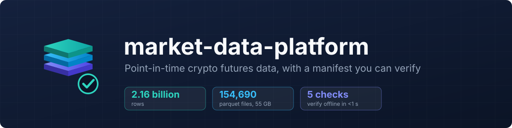
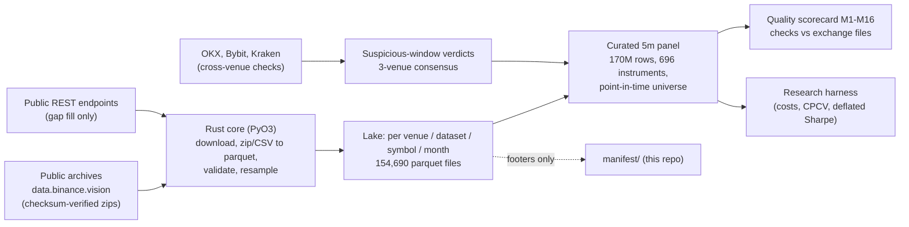

<p align="center">
  
</p>

<p align="center">
  <a href="LICENSE"></a>
  
  
  
  
</p>

<p align="center">
  <a href="#verify-it-yourself-in-60-seconds">Verify</a> &nbsp;·&nbsp;
  <a href="#architecture">Architecture</a> &nbsp;·&nbsp;
  <a href="#quality-and-bias-guarantees-and-what-enforces-them">Guarantees</a> &nbsp;·&nbsp;
  <a href="CONSULTANT_BRIEF.md">One-page brief</a> &nbsp;·&nbsp;
  <a href="docs/DESIGN.md">Design</a> &nbsp;·&nbsp;
  <a href="docs/RESEARCH.md">Research</a>
</p>

# market-data-platform

| | |
|---|---|
| **What** | A point-in-time lake of crypto futures market data, and the evidence that it is what it claims to be |
| **Scale** | 2.16 billion rows in 154,690 parquet files (55 GB), Binance USD-M with cross-venue checks |
| **Proof** | A manifest generated from file metadata, a verifier that fails on any change, and bias tests that change future data |
| **Not included** | The data itself (exchange terms limit redistribution); a synthetic sample ships instead |

A private, point-in-time data lake of crypto futures market data (Binance USD-M, cross-checked against OKX, Bybit
and Kraken): 2.16 billion rows in 154,690 parquet files. It is built so that a backtest reads no value before its
publication time and keeps delisted coins, and its sampled bars equal the exchange's own files. This repository
holds the evidence: a machine-generated manifest of the lake, the tools that produce and check it, the design and
audit documents, and the tests that enforce the bias rules. The 55 GB of data is not included because it is not
redistributable.

## Verify it yourself in 60 seconds

Needs Python 3.10+ and two packages; no data download.

```bash
python3 -m venv .venv && .venv/bin/pip install numpy pyarrow
.venv/bin/python tools/verify.py --sample      # 5 checks on the bundled synthetic lake, under 1 second
.venv/bin/python tools/verify.py --inventory   # the inventory table below, printed from manifest/manifest.json
```

Expected output of the first command:

```
[PASS] 1 sample manifest recomputes exactly
[PASS] 2 sample schemas equal the real lake's schemas
[PASS] 3 tamper test: one deleted row is detected
[PASS] 4 quality scan finds exactly the planted defects
[PASS] 5 5m bars equal the traded-minute resample of 1m
VERIFY SAMPLE: PASS
```

What each check shows: (1) the manifest tool is deterministic; (2) the sample has exactly the column names and types
of the real partitions, compared by hash against the real manifest; (3) removing a single row from one file changes
the manifest and fails verification; (4) the validator rules find the four defects planted in the sample and report
nothing else; (5) 5-minute bars are rebuilt from 1-minute bars with the exchange's rule.

What you cannot check without the data: that the manifest describes a lake that exists. Two ways to close that gap:

- Spot-check one file against the public source. `manifest/manifest_files.tsv.gz` lists every file with its row
  count. For example `binance_um/klines/1m/BTCUSDT/2024-02.parquet` has 41,760 rows (29 days x 1,440 minutes);
  download the public file `BTCUSDT-1m-2024-02.zip` (USD-M futures, monthly klines) from data.binance.vision and
  count its data rows. Other Binance symbol-months can be checked the same way; a month that was gap-filled from
  the daily archive (for example SANDUSDT 2022-02) has more rows than its short monthly zip.
- Ask for a live run. On the machine that holds the lake, `python tools/verify.py <lake>` recomputes all
  154,690 footers in about 15 seconds and compares them with the committed manifest, down to a sha256 over every
  file path and size (`58a72a8c...`). Any added, removed or resized file fails it.

## Architecture



Rust does the work that touches every row (parsing, validation, resampling, the simulator); Python does
orchestration, the panel build in Polars, the quality scorecard and research glue. Contracts are in
[docs/DESIGN.md](docs/DESIGN.md).

## Data inventory

Per-symbol market-data partitions of the lake, from [manifest/manifest.json](manifest/manifest.json)
(`python tools/verify.py --inventory`). Dates are UTC; the data runs to 2026-10-21.

| Partition | Symbols | Files | Rows | GB | From | To |
|---|---:|---:|---:|---:|---|---|
| `binance_spot/klines_5m` | 353 | 17,132 | 148,382,223 | 4.43 | 2019-09-01 | 2026-09-30 |
| `binance_um/funding` | 987 | 987 | 2,944,074 | 0.01 | 2020-01-01 | 2026-09-30 |
| `binance_um/indexPriceKlines/5m` | 948 | 21,670 | 184,681,414 | 5.01 | 2020-01-01 | 2026-10-21 |
| `binance_um/klines/1m` | 1,041 | 24,558 | 1,042,219,227 | 25.40 | 2020-01-01 | 2026-10-21 |
| `binance_um/klines/5m` | 1,065 | 25,371 | 214,735,551 | 6.47 | 2020-01-01 | 2026-10-21 |
| `binance_um/markPriceKlines/5m` | 963 | 22,505 | 191,459,127 | 4.17 | 2020-01-01 | 2026-10-21 |
| `binance_um/metrics` | 683 | 2,158 | 155,696,735 | 5.58 | 2020-09-01 | 2026-10-21 |
| `binance_um/premiumIndexKlines/5m` | 953 | 20,949 | 177,332,582 | 3.46 | 2020-01-01 | 2026-10-21 |
| `binance_um/rest/funding` | 786 | 786 | 79,370 | 0.00 | 2026-10-01 | 2026-10-21 |
| `binance_um/rest/klines/1m` | 35 | 47 | 491,758 | 0.02 | 2021-01-05 | 2026-09-25 |
| `binance_um/rest/markPriceKlines/5m` | 22 | 22 | 6,336 | 0.00 | 2026-10-07 | 2026-10-18 |
| `binance_um/rest/metrics` | 76 | 76 | 706 | 0.00 | 2026-09-24 | 2026-10-15 |
| `binance_um/rest/premiumIndexKlines/5m` | 40 | 80 | 246,528 | 0.01 | 2021-01-25 | 2026-10-18 |
| `okx/bars_5m` | 335 | 14,337 | 4,129,056 | 0.22 | 2021-10-01 | 2026-09-30 |

| Scope | Files | Rows | GB |
|---|---:|---:|---:|
| Whole lake | 154,690 | 2,157,688,483 | 55.21 |
| Primary (per-symbol series + single tables, no intermediate copies) | 150,689 | 2,139,150,678 | 54.92 |
| Per-symbol market data (table above) | 150,678 | 2,122,404,687 | 54.77 |
| Curated research panel, current version ([manifest](manifest/curated_panel_manifest.json)) | 11 | 173,628,168 | 12.68 |

The earlier figure of "about 2.5 billion rows in 160,000+ files" counts the whole private `data/` folder, including
a rollback copy of the panel and build scratch; [manifest/README.md](manifest/README.md) reconciles the two.

## Quality and bias guarantees, and what enforces them

| Guarantee | Enforced by |
|---|---|
| No look-ahead: a value is used only after its publication time | [method/point_in_time/panel_inputs.py](method/point_in_time/panel_inputs.py) (`visible_rows`), perturbation tests in [test_panel_rebuild_bybit.py](method/tests/bias_checks/test_panel_rebuild_bybit.py) and [test_context.py](method/tests/bias_checks/test_context.py) |
| Point-in-time universe from data up to the previous day; delisted coins stay in | `test_universe_lookahead` in [test_panel.py](method/tests/bias_checks/test_panel.py) |
| One instrument per listing when the exchange reuses a ticker (a survivorship and fake-jump error found while checking the data) | listing tests in [test_panel.py](method/tests/bias_checks/test_panel.py) |
| Resampled bars follow the exchange's own rule (traded minutes only) | [test_resample_traded.py](method/tests/equality/test_resample_traded.py) |
| Bad prints are flagged and kept in the data; data-cleaning flags that look one bar ahead are never read by features | [test_panel_rebuild_r5.py](method/tests/bias_checks/test_panel_rebuild_r5.py) (source scan) |
| Every scorecard metric green or proven unfixable from free sources; a regression reopens it | [docs/quality_proofs.md](docs/quality_proofs.md), [method/quality/](method/quality/) |
| Fast Rust code equals its slower reference | [test_core_bars.py](method/tests/equality/test_core_bars.py), [test_bookticker_rust.py](method/tests/equality/test_bookticker_rust.py) |
| Research is pre-registered: rules, trial budget and success criteria fixed before results, holdout sealed | [docs/RESEARCH.md](docs/RESEARCH.md) |

## What was learned

- Most of the work was in the data. Checking the finished-looking dataset against the exchange's own files turned up
  defects, the worst being tickers the exchange reused for a new coin: they silently stitched a dead coin's history
  onto the new one. The fix is one instrument per listing, covered by tests.
- A momentum strategy from an earlier project does not survive on this data. Rebuilt with funding, delisted coins
  and realistic costs: out-of-sample Sharpe -0.12 to -0.91, probability of backtest overfitting 0.94. Null result.
  The earlier positive result came from a fixed list of surviving coins, no funding costs and a reused holdout.
- Funding carry is real but small and fading. An exploratory, unregistered test of a hedged funding-carry trade
  earned most of its return in 2021 (+25.7% of capital), then +0.3% to +9.1% a year, +1.4% for 2025 to September;
  exchange-failure and auto-deleveraging risks are not priced. Not claimed as an edge.
- The pre-registered main study has not been run. There is no registered result yet.

Timeline: [docs/TIMELINE.md](docs/TIMELINE.md).

## What this is not

- Not a trading system with an edge. No profit, live trading or production deployment is claimed.
- Not a public dataset. The lake stays private; Binance archive data is CC BY-NC-SA 4.0 and the other venues'
  terms are unclear or restrictive ([docs/DATA_LICENSES.md](docs/DATA_LICENSES.md)). The sample here is synthetic.
- Not a runnable copy of the platform. The files in [method/](method/) are read-only excerpts that import private
  packages; the runnable parts here are the three tools in `tools/`.
- Not independently audited. No third party has reviewed the data or the code; only the manifest and the tools in
  `tools/` can be re-run from this repository.

## Skills demonstrated

| Skill | Where to look |
|---|---|
| Data engineering at scale (billions of rows, partitioned parquet, Rust + Python) | [manifest/manifest.json](manifest/manifest.json), [docs/DESIGN.md](docs/DESIGN.md) |
| Point-in-time correctness and survivorship control | [method/point_in_time/panel_inputs.py](method/point_in_time/panel_inputs.py), [method/tests/bias_checks/](method/tests/bias_checks/) |
| Validation discipline: rules, scorecard, equality tests against reference implementations | [method/quality/](method/quality/), [method/tests/equality/](method/tests/equality/) |
| Reproducibility: manifests, hashes, tamper detection, pre-registration | [tools/verify.py](tools/verify.py), [docs/RESEARCH.md](docs/RESEARCH.md) |
| Licence and compliance awareness | [docs/DATA_LICENSES.md](docs/DATA_LICENSES.md) |

## How this was built

The work ran from 2026-10-19 to 2026-10-24. I set the design, the rules (no look-ahead, point-in-time universe,
sealed holdout, costs always on, public keyless sources only) and the acceptance checks, and I review the results
against them. Every claim above points to a test, a check against the exchange's files or the manifest, so it can be
rerun.

## Repository layout

```
README.md               this page
CONSULTANT_BRIEF.md     one-page summary for a non-specialist
manifest/               lake, panel and data-folder manifests (+ how they were produced)
tools/                  build_manifest.py, verify.py, make_synthetic_sample.py
sample/                 synthetic lake (1.8 MB), its manifest, the planted defects
method/                 read-only source excerpts: point-in-time rules, quality checks, bias and equality tests
docs/                   design, pre-registration, licences, quality proofs, timeline
```

## Licence

The code and documents are released under the MIT licence ([LICENSE](LICENSE)). No market data is included. Data credit for the private lake: "Data: Binance Vision (data.binance.vision),
CC BY-NC-SA 4.0."
